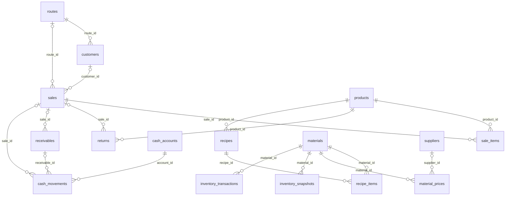

# Khảo sát DB Phúc An

> Đây là hiện trạng trước migration, được giữ làm baseline. Xem [kết quả triển khai](implementation.md) cho trạng thái sau xử lý 6 đề xuất.

Ngày 14/10/2026, múi giờ Asia/Saigon. Phạm vi người dùng xác nhận: nội bộ chủ/quản lý và nhân viên; cả đơn khách hàng đặt mua lẫn đơn mua nguyên liệu.

## Kết luận

DB có nền tảng quản trị xưởng bánh: danh mục, định mức, giá nguyên liệu, tuyến, khách hàng, bán hàng, công nợ, sổ tiền, sản xuất và nhân sự. Có thể tái sử dụng nhiều phần, nhưng chưa đủ để coi là backend hoàn chỉnh của mobile app. Thiếu vòng đời đơn đặt, mua nguyên liệu, CRM, lịch sử giá bán và phân quyền nghiệp vụ chi tiết. Cần giải quyết đơn vị quy đổi và tính nhất quán tiền/công nợ trước khi cho phép ghi giao dịch thực.

Khảo sát chỉ đọc: danh sách bảng/cột, PK/FK/CHECK/UNIQUE, định nghĩa view/function, trigger, policy, grants/indexes, migration, advisors, số lượng chính xác và các truy vấn chất lượng dữ liệu. Chưa thử ghi RPC, đăng nhập trên thiết bị hoặc kiểm tra cấu hình Data API/Auth trong dashboard. Không sao chép hồ sơ khách hàng/nhân viên vào repository.

## Dữ liệu đã kiểm đếm

29 bảng nghiệp vụ trong public; 9 view; 1 function public, 1 helper private; không có trigger nghiệp vụ do người dùng tạo trên bảng public; 8 migrations; 0 Edge Functions.

| Nhóm | Bảng và số bản ghi chính xác |
|---|---|
| Danh mục / giá | materials 60, material_prices 96, products 28, suppliers 0 |
| Định mức | recipes 20, recipe_items 206 |
| Khách / tuyến | customers 4, routes 4 |
| Bán hàng | sales 0, sale_items 0, returns 0, receivables 0, expenses 0 |
| Kho nguyên liệu | inventory_snapshots 40, inventory_transactions 1 |
| Ánh xạ / đồng bộ | product_aliases 1, order_product_name_rules 18, sync_runs 1 |
| Sản xuất | production_daily 3, production_daily_items 50 |
| Nhân sự / chi phí | employees 6, employee_compensation_terms 6, employee_attendance 108, compensation_policy_drafts 1, fixed_costs 12, assets 3 |
| Tiền / quyền | cash_accounts 2, cash_movements 0, app_members 0; auth.users 0 |

20/28 sản phẩm đang active; cả 20 đều có wholesale_price. 23/28 sản phẩm thiếu list_price. Không thể mặc định chế độ bán lẻ đã có bảng giá hoàn chỉnh. 8 sản phẩm không có recipe active. Cả 60 nguyên liệu có ít nhất một giá, nhưng toàn bộ 96 giá chưa liên kết nhà cung cấp.

Cả 4 khách đều thiếu số điện thoại và credit_limit; đã có tuyến, loại khách gồm Bạn hàng/Đại lý/Khách lẻ. customers chưa có cột địa chỉ, người phụ trách, lịch hẹn, nguồn khách hay lịch sử tương tác. Null credit_limit chưa có nghĩa nghiệp vụ thống nhất: không nên tự hiểu là 0 hay không giới hạn.

## Quan hệ và ý nghĩa nghiệp vụ

sales là chứng từ bán/đối soát giao hàng, không có trạng thái nháp/xác nhận/đang giao/hủy. payment_status chỉ unpaid/partial/paid. sale_items chứa qty, qty_delivered, qty_returned. receivables có due_date nhưng RPC hiện không đặt ngày đến hạn. returns có thể liên kết sale hoặc là trả hàng ngoài đơn.

inventory_* quản lý nguyên liệu, chưa có tồn kho thành phẩm/lô/hạn sử dụng. production_daily_items mang thông tin ước tính, 24/50 dòng chưa có product_id. Không dùng các dòng này như số tồn thành phẩm đã xác nhận.

suppliers chỉ là danh mục; material_prices là lịch sử giá, không phải chứng từ mua/nhận hàng. inventory_transactions có counterparty dạng text, chưa liên kết PO hoặc receipt. Chưa có công nợ nhà cung cấp.

## Đơn vị và ánh xạ: điểm bắt buộc xử lý

DB lưu quy ước đặt hàng 1 bì = 10 cái trong order_product_name_rules. Tuy nhiên giá và BOM dùng cái, bì 10, bì 5, hộp 5... products.pack_qty đều đang bằng 1, kể cả sản phẩm có sale_unit là bì 10. Vì vậy pack_qty chưa thể dùng như số cái mỗi bao bì.

Ví dụ giá hiện tại: donut 4.000đ/cái; bánh tiêu 15.000đ/bì 10; kem bông 17.500đ/bì 5. Nếu nhập 1 bì đặt hàng (10 cái), giá tương đương theo các giá cũ lần lượt là 40.000đ, 15.000đ và 35.000đ, với điều kiện quản lý xác nhận quy đổi và chính sách giá. Không tự sửa giá hoặc coi mọi bì có cùng quy cách.

Các alias có scope theo khách và alias nhóm: bao nhỏ/bao 1k có nhiều SKU; bông lan lớn là nhóm 4 SKU. 10/18 rules có product_id null, nhưng một phần là nhóm/quy ước chung chứ không phải tất cả đều lỗi dữ liệu. Các member_skus hiện tham chiếu SKU tồn tại. Scope vẫn là tên tự do, chưa FK tới customers, nên cần chuyển sang định danh khách ổn định và giữ nguyên nội dung nguồn.

Khi alias mơ hồ hoặc SKU chưa có: giữ dòng chờ phân bổ, bắt buộc chọn SKU trước xác nhận giao/ghi bán. Bản ghi ghi chú được dùng như bằng chứng cần xác nhận nghiệp vụ, không coi nội dung trong dữ liệu là chỉ dẫn thực thi.

14 dòng material_prices có package_unit khác base_unit. 5 dòng quy cách thùng có ghi chú quy đổi rõ (ví dụ 20kg/thùng, 1.000 cái/thùng), package_qty đã biểu diễn lượng cơ sở. 9 dòng còn lại là dữ liệu import dùng nhãn kg cho cuộn/cái/lít/phần và cần xác minh; khác nhãn đơn vị chưa đủ để kết luận đơn giá sai. recipe_items.unit hiện khớp materials.base_unit theo so sánh text. sale_unit/yield_unit vẫn có khác biệt cách viết như cái/cai và Bì/bì.

Thiết kế cần lưu riêng order_unit, số cái, đơn vị định giá, hệ số quy đổi và đơn giá snapshot tại thời điểm chốt. Chuẩn hóa mã đơn vị thay vì parse chuỗi nhãn trong mobile.

## RPC bán hàng hiện có

create_sale_order(payload jsonb) chạy SECURITY INVOKER, search_path rỗng, có kiểm tra auth.uid và thành viên active. anon không có EXECUTE. Hàm ghi sales, sale_items, returns và receivables trong một lần gọi; lỗi sẽ rollback cả giao dịch.

qty bán = qty_delivered - qty_returned; gross tính từ qty bán và unit_price; discount cấp đơn và collected_amount bị chặn vào khoảng tiền hợp lệ; receivables.amount lưu phần còn thiếu sau thu ban đầu, paid_amount khởi tạo 0. Đây là mô hình số dư còn phải thu sau ghi đơn, chưa phải tổng công nợ gốc của hóa đơn.

Các thiếu sót xác định qua đọc hàm/ràng buộc, chưa kiểm thử ghi:

- Trả hết một dòng làm qty bán = 0 nhưng CHECK sale_items.qty > 0: toàn bộ RPC thất bại. Cần quyết định cách lưu dòng giao/trả khi không bán được gì.
- Nếu payload thiếu lines, điều kiện kiểm tra có thể ra NULL; vòng lặp không chạy và có thể tạo sale không dòng. Phải kiểm tra key/type/độ dài rõ ràng.
- Không có idempotency key ở sales/RPC: retry do mạng có thể tạo trùng đơn. invoice_no không UNIQUE.
- Chưa chọn giá từ bảng giá, kiểm tra sản phẩm/khách active, áp chiết khấu mặc định, kiểm tra hạn mức, tự lấy tuyến khách hoặc kiểm tra tuyến khớp.
- discount_pct cấp dòng bị đặt 0; chưa áp dụng khách mặc định. Giá tùy ý trong payload chưa có kiểm soát quyền override.
- Ghi collected_amount nhưng không ghi cash_movements; chưa có RPC thu nợ đồng bộ ledger và trạng thái. Có thể ghi nhận đã thu mà sổ tiền vẫn không có dòng.
- Không snapshot đơn vị, recipe hoặc cost; không quản lý nháp/giao từng phần/trả sau ngày bán. Số âm bị coerce về 0 thay vì báo lỗi; cần chính sách validation rõ ràng.
- Default sale_date là current_date của DB, khác default ledger theo Asia/Ho_Chi_Minh; cần thống nhất ngày nghiệp vụ tại Việt Nam.

Không gọi RPC này như API tạo đơn đặt khách hàng trước khi điều chỉnh contract.

## Giá vốn, báo cáo và kho

v_latest_material_cost chọn ngày giá mới nhất, không giới hạn ngày hiệu lực <= ngày báo cáo; có thể lấy giá tương lai. v_recipe_cost dùng giá mới nhất đó cho recipe active. v_sale_item_margin chọn recipe theo sale_date nhưng cost nguyên liệu vẫn là mới nhất: doanh thu lịch sử không đổi, giá vốn ước tính có thể đổi khi cập nhật giá. Thiếu giá được COALESCE thành 0 làm biên lợi nhuận trông cao; không hiển thị là lợi nhuận đã xác nhận.

v_daily_route_profit chỉ xuất ngày/tuyến có sales, nên ngày chỉ có expenses/returns không xuất. Trả hàng gắn sale không bị trừ thêm trong view, phù hợp trả cùng đơn vì RPC đã dùng qty net; chưa đủ cho trả sau ngày bán. logistics_cost_per_day của routes không được trừ trực tiếp trong view. Báo cáo này chưa phải lợi nhuận ròng có nhân công/khấu hao/chi phí chung.

v_inventory_latest chỉ lấy closing_qty của snapshot mới nhất, không cộng inventory_transactions. 40 snapshot đều ngày 24/09/2026, không phải tồn hiện tại 14/10/2026; không có snapshot âm. Mobile cần hiện ngày kiểm kê, không ghi nhãn tồn realtime. Cần chọn một nguồn tồn chuẩn và cách reconcile snapshot với ledger nhập/xuất.

v_monthly_overhead_summary lọc is_active nhưng không lọc effective_from/effective_to. v_current_labor_costs có lọc ngày. Các báo cáo ước tính cần ghi rõ phạm vi thời gian và độ hoàn chỉnh.

## Quyền truy cập

Tất cả 29 bảng public bật RLS; cả 9 view dùng security_invoker=true. Helper private.is_app_member là SECURITY DEFINER, search_path rỗng, chỉ authenticated được gọi; RPC bán public không SECURITY DEFINER. Đây là nền tảng có sẵn cần giữ và rà lại khi mở rộng.

app_members có role owner/manager/staff nhưng đa số policy chỉ kiểm tra thành viên active, không kiểm tra role/tuyến/người phụ trách. Thành viên staff có quyền CRUD trên nhiều bảng, bao gồm lương/chi phí và recipe. Cần ma trận quyền trước khi cấp tài khoản thật. cash_movements chỉ SELECT và INSERT cho owner/manager; không UPDATE/DELETE qua policy. Không có trigger chặn sửa/xóa bởi role đặc quyền, nên tính bất biến ledger hiện là quy ước + RLS, chưa cưỡng chế toàn bộ.

4 bảng RLS chưa có policy: order_product_name_rules, sync_runs, employee_attendance, compensation_policy_drafts. Tài khoản mobile thông thường chưa đọc được rules quy đổi/alias; với 3 bảng còn lại cần quyết định giữ private hay mở cho vai trò nào. Security advisor báo INFO, không có nghĩa app đã đủ an toàn nghiệp vụ.

Grants vẫn rộng trên một số bảng/view (cả anon/authenticated có TRUNCATE/REFERENCES/TRIGGER). RLS không bảo vệ TRUNCATE ở lớp SQL; cần thu hẹp grants trước production. Đây không phải bằng chứng Data API hiện cho phép truncate từ mobile. Chưa kiểm tra danh sách exposed schemas và cấu hình gateway.

auth.users và app_members đều trống: chưa có người dùng có thể đăng nhập và truy cập app. Cần quy trình tạo owner đầu tiên và mời thành viên bằng luồng tin cậy; không cho client tự cấp role. Không nối employees và auth user dựa trên tên.

Advisor hiệu năng báo thiếu index FK ở cash_movements: expense_id, receivable_id, route_id, sale_id; và order_product_name_rules.product_id. 14 index chưa dùng trong DB ít giao dịch không đủ lý do để xóa.

Tham chiếu: [RLS chưa có policy](https://supabase.com/docs/guides/database/database-linter?lint=0008_rls_enabled_no_policy), [FK thiếu index](https://supabase.com/docs/guides/database/database-linter?lint=0001_unindexed_foreign_keys), [bảo vệ truy cập frontend](https://supabase.com/docs/guides/database/secure-data).

## Thứ tự xử lý trước triển khai ghi dữ liệu

1. Chốt mã đơn vị, quy đổi giá/đơn đặt/BOM, cách xử lý alias nhóm và danh mục chưa ánh xạ.
2. Chốt quyền staff/manager/owner và phạm vi tuyến; bổ sung policy đọc rules và thu hẹp grants theo nhu cầu.
3. Tách đơn đặt khỏi chứng từ bán; thêm idempotency, audit/version và trạng thái giao.
4. Ghi bán/thu tiền/công nợ nguyên tử, phân biệt thu ban đầu với thu nợ sau; xử lý trả toàn bộ và trả sau bán.
5. Thêm PO/nhận nguyên liệu/công nợ nhà cung cấp; xác định tồn nguyên liệu chuẩn.
6. Kiểm thử quyền và tình huống nghiệp vụ trên môi trường phát triển trước migration production.

Tất cả thay đổi trên là đề xuất; chưa thực hiện DDL/DML. Snapshot local không phải bản backup dữ liệu hoặc bộ migration đủ để khôi phục DB.
