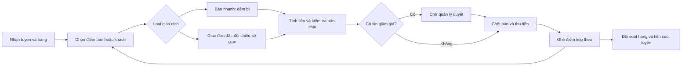

# Nghiên cứu không gian làm việc cho nhân viên bán hàng tuyến

Ngày: 14/10/2026. Phạm vi: tuyến Chợ huyện của Phúc An; nghiên cứu nghiệp vụ, giao diện và khoảng trống dữ liệu. Đây là đề xuất thiết kế, chưa triển khai màn hình hoặc thay đổi quyền/DB.

Kết luận: nhân viên cần một không gian bán hàng theo tuyến/ngày, với bán nhanh, giao đơn đã đặt, bạn hàng và đối soát hàng/tiền. Giao diện hiện tại mới khác nhau một phần theo role; chưa hỗ trợ trọn công việc bán trực tiếp.

## Cập nhật thiết kế theo phản hồi về tốc độ

Menu POS bổ sung tìm món theo tên/tên thường gọi, nhóm Món hay lấy/Bánh ngọt/Bánh mặn/Tất cả và ô món nhỏ ba cột. Món hay lấy hiển thị theo khách; khách mới dùng danh sách chung, không tự giả lập lịch sử mua. Tìm kiếm áp dụng toàn danh mục để không bỏ sót món ngoài nhóm đang chọn. Vùng menu cuộn độc lập theo yêu cầu người dùng; giỏ, ghi chú và tổng tiền nằm ngoài vùng cuộn. Bản thử có thêm món/giá minh họa để kiểm tra bố cục, không coi các món/giá đó là danh mục Supabase đã xác minh.

Phản hồi tiếp theo yêu cầu trải nghiệm POS. Hướng được chọn thay cho bảng nhập đơn: các ô món có tên/giá/quy cách, chạm một lần thêm một bì vào giỏ; giỏ luôn hiện số lượng và thành tiền. Ba nút giảm, tăng và xóa đặt ngay trong mỗi dòng giỏ; số lượng là ô nhập trực tiếp bằng bàn phím số, không mở ô chỉnh riêng. Chọn/tạo khách trong ô ở đầu POS, tải món quen và quy cách tương ứng; ghi chú ngay trong giỏ. Chốt bản thử xong mở chọn khách tiếp. Không đặt xin giảm giá, cho nợ hoặc biểu mẫu thanh toán dài vào màn hình này. Bản thiết kế chưa ghi giao dịch hay xác nhận thu tiền trên backend.

Phản hồi mới nhất thay thế bố cục Bán nhanh ở mục 5: chọn khách quen bằng một chạm hoặc gõ tìm; không thấy khách thì tạo ngay từ tên đã gõ, chưa bắt điền hồ sơ dài. Danh sách món, thứ tự món quen, giá áp dụng và quy cách lấy theo hồ sơ khách. Khách mới dùng cấu hình tuyến/bảng giá mặc định, không tự suy đoán giá riêng.

Số lượng nhập trực tiếp vào các ô lớn trên cùng danh sách; ô đang nhập chọn toàn bộ số khi chạm, Enter chuyển món tiếp. Đơn vị bì/cái đặt cạnh ô, thành tiền tự cập nhật. Lấy đơn gần nhất là thao tác chủ động, không tự điền lại số lượng cũ. Đổi khách trong một giỏ đang nhập giữ lượng cơ sở theo món và đổi cách biểu diễn theo quy cách của khách, có thông báo rõ.

Bỏ xin giảm giá và cho nợ khỏi luồng nhập đơn của bản thiết kế mới. Thêm ghi chú ngay dưới danh sách món. Nút cuối là Lưu đơn · Khách tiếp, lưu món/số lượng/khách/ghi chú rồi đưa con trỏ về tìm khách. Việc lưu đơn không tự ghi rằng đã thu tiền. Bản thử tương tác không ghi DB và chưa thay đổi chính sách công nợ/phân quyền của backend hiện hành.

## 1. Những điều đã được xác nhận

- Người sử dụng là chủ/quản lý và nhân viên nội bộ; ưu tiên iOS.
- Nhân viên tuyến vừa mang hàng bán ngay, vừa giao đơn khách đã đặt trước.
- Người dùng xác nhận: được bán chịu trong quyền, tối đa 30% giá trị đơn hàng; giảm giá phải xin duyệt.
- Đăng nhập số điện thoại + mật khẩu do owner cấp, giữ nguyên luồng này.
- Nhân viên thường xuyên đếm bì, tính tiền và ghi nhận khách/bạn hàng. Đây là thông tin do người dùng cung cấp, chưa có quan sát trực tiếp ngoài chợ.

Cách diễn giải để thiết kế: 30% tính trên số tiền thực phải trả sau giảm giá đã được duyệt; cần thu ít nhất 70%. Chưa tự áp dụng cách diễn giải này vào DB. Khi giao từng phần, đề xuất kiểm soát cả chứng từ phần đã giao và số dư lũy kế đơn; cần chốt chính xác trước triển khai.

## 2. Bằng chứng từ app và Supabase hiện tại

Đã kiểm tra bằng truy vấn chỉ đọc và đọc source hiện hành, không sử dụng báo cáo khảo sát cũ như trạng thái hiện tại.

| Hạng mục | Kết quả kiểm tra | Ý nghĩa |
|---|---|---|
| Tuyến Chợ huyện | R-CHO_HUYEN, đang hoạt động, 2 khách | Có nền tảng danh mục tuyến thật |
| Tổng danh mục | 4 tuyến, 4 khách; tuyến Đại lý đang tắt | Chưa suy ra lịch đi tuyến hoặc quy mô hoạt động thực tế |
| Phân công tuyến | route_assignments có 0 dòng | Chưa có phân công tuyến qua bảng này; vẫn có cơ chế giao khách trực tiếp qua assigned_to |
| Đơn và chứng từ bán | customer_orders = 0, sales = 0 | Không có lịch sử để đo tần suất, giỏ hàng phổ biến, tốc độ hay thói quen thu tiền |
| Màn hình đầu | Home.tsx hiện số đơn cần giao, khách trong phạm vi, việc chăm sóc | Chưa có tuyến/ca đang làm, hàng đang giữ hoặc tiền cần bàn giao |
| Quyền tạo khách | Customers.tsx và policy INSERT chỉ owner/manager | Nhân viên không thể thêm bạn hàng mới ngay tại điểm bán |
| Chốt/giao/thu tiền | transition_customer_order, post_delivery, collect_receivable yêu cầu owner/manager | Staff chỉ tạo nháp; giao diện mới phải đi cùng quyền nghiệp vụ mới |
| Phạm vi đọc | private.can_customer dựa trên khách giao trực tiếp hoặc tuyến được phân công | Nhìn thấy khách trong tuyến chưa đồng nghĩa giao dịch/tiền đó do chính mình thực hiện |
| Công việc | customer_tasks có người được giao và trạng thái | Tái sử dụng cho hẹn/nhắc; chưa phải danh sách điểm ghé của một chuyến |
| Tồn hàng | Có tồn nguyên liệu; chưa có mô hình giao nhận thành phẩm theo chuyến/người giữ | Không được dùng v_material_stock để nói nhân viên còn bao nhiêu bì bánh |
| Mất mạng | mutations.ts giữ một yêu cầu chưa rõ kết quả và chặn yêu cầu mới khác key | Có retry chống ghi trùng, chưa phải bán nhiều đơn khi mất mạng |
| Giá | product_units + selling_prices + snapshot đơn đã có | Có thể tái sử dụng quy đổi và lịch sử giá; không tự sửa giá nguồn |

Source chính: src/screens/Home.tsx, Customers.tsx, Orders.tsx; src/lib/data.ts, mutations.ts; supabase/migrations/20261014023700_mobile_operations_v1.sql và các migration bổ sung.

### Quy đổi bì: điểm phải thể hiện rõ

Theo DB ngày nghiên cứu, một đơn vị bì đặt hiện quy đổi 10 cái. Giá sỉ hiện hành, không có giá riêng theo khách trong các dòng dưới:

| Sản phẩm | Giá nguồn | Quy đổi 1 bì đặt = 10 cái | Giá theo bì đặt |
|---|---|---|---|
| Bánh donut | 4.000đ/cái | 10 × 4.000đ | 40.000đ |
| Bánh kem bông | 17.500đ/bì 5 cái | 10/5 × 17.500đ | 35.000đ |
| Bánh tiêu | 15.000đ/bì 10 cái | 10/10 × 15.000đ | 15.000đ |

Đây là quy đổi của DB, chưa chứng minh mọi bao bì vật lý ngoài chợ đều chứa 10 cái. Khi khảo sát thực địa cần xác nhận có bán nửa bì, cái lẻ, mở bì hoặc quy cách khác không. Phần mềm phải phân biệt bì đang đếm, số cái và đơn vị định giá; không parse chữ “bì” để tính tiền.

## 3. Tham khảo mô hình vận hành

Salesforce mô tả van sales là mang hàng theo tuyến, tạo đơn theo nhu cầu tại điểm và giao ngay từ hàng đang mang. Ở thị trường truyền thống, một nhân viên có thể làm nhiều nhiệm vụ: bán, giao và chăm sóc; phần mềm cần giao diện theo công việc và quản lý hàng/tiền của chuyến. Mô hình này tương đồng với yêu cầu người dùng, nhưng không chứng minh Phúc An đã vận hành đầy đủ các bước đó. [Nguồn chính thức](https://trailhead.salesforce.com/content/learn/modules/direct-store-delivery-and-van-sales-basics-in-consumer-goods-cloud/get-started-with-direct-store-delivery-and-van-sales).

Odoo POS tách phương thức tiền mặt, ngân hàng và tài khoản khách; phương thức ghi vào tài khoản khách có yêu cầu nhận diện khách. Tham khảo để tách tiền đã thu và bán chịu, không coi nhập “khách đưa” là đã thu toàn bộ số đó. [Nguồn chính thức](https://www.odoo.com/documentation/20.0/applications/sales/point_of_sale/payment_methods.html).

Không đề xuất mua các sản phẩm trên; chỉ tham khảo cách tổ chức nghiệp vụ.

## 4. Một ngày làm việc đề xuất



**Đầu tuyến:** hiện đúng nhân viên, tuyến, ngày/chuyến; danh sách đơn đặt và điểm cần ghé. Xác nhận số hàng thực nhận theo SKU/quy cách, tiền lẻ đầu ca nếu có. Hàng chỉ được tính là nhân viên đang giữ khi giao nhận đã xác nhận.

**Tại điểm:** tìm nhanh bạn hàng; chọn Bán ngay hoặc Giao đơn đã đặt. Cả hai dùng chung công cụ đếm bì và tính tiền, nhưng giao đơn đặt phải đối chiếu lượng còn được giao, giá đã chốt và các lần giao trước.

**Sau mỗi giao dịch:** cập nhật hàng còn mang, tiền thực thu, nợ mới, trạng thái ghé; cho ghi ngắn “khách đóng cửa”, “hẹn quay lại”, “không mua”. Không bắt nhập một ghi chú CRM dài cho mọi lần bán.

**Cuối tuyến:** kiểm đếm hàng bán được còn lại, hàng trả/hỏng; đối chiếu tiền mặt, chuyển khoản, nợ và số cần bàn giao. Chênh lệch có lý do và người xác nhận; chưa duyệt thì vẫn là chờ đối soát.

## 5. Giao diện riêng cho nhân viên tuyến

Đề xuất 4 mục: **Tuyến hôm nay · Bán nhanh · Bạn hàng · Cá nhân**. Đơn đã đặt, hàng đang mang và đối soát đặt trong ngữ cảnh tuyến. Giao diện chủ/quản lý giữ nhóm công cụ quản trị hiện có.

### Tuyến hôm nay

- Tên nhân viên, tuyến/chuyến đang làm; nhiều tuyến thì chọn trong các tuyến được giao.
- Nút chính: Bán ngay. Nút phụ: Giao đơn đã đặt.
- Số liệu cá nhân/chuyến: hàng đang giữ, tiền mặt đang giữ, chuyển khoản ghi nhận, nợ mới, điểm còn ghé.
- Việc được giao, hẹn đến hạn và đơn cần giao của chuyến; không chỉ lọc mọi đơn có cùng ngày.
- Chưa được phân công: hướng dẫn liên hệ quản lý, không hiện một dashboard toàn công ty hoặc gán tuyến đầu tiên tự động.
- Mọi con số gắn rõ phạm vi, thời điểm cập nhật và trạng thái đồng bộ. Nếu cả nhóm cùng tuyến, tách “Của tôi” và “Toàn tuyến” theo quyền.

### Bán nhanh / công cụ đếm bì

```text
CHỢ HUYỆN · ĐIỂM BÁN ĐANG CHỌN
Bạn hàng: [Tìm tên / số điện thoại] [+ Thêm nhanh]

Donut       40.000đ / bì 10 cái     [−] 2 [+]
Kem bông    35.000đ / bì 10 cái     [−] 1 [+]
Bánh tiêu   15.000đ / bì 10 cái     [−] 3 [+]

6 bì · 60 cái                  Tổng 160.000đ
[Xin giảm giá]                 Chưa có giảm giá
Thu tối thiểu                 112.000đ
Được ghi nợ tối đa             48.000đ
[Thu đủ] [Thu một phần] [Chuyển khoản]
[Chốt bán & ghi thu]
```

Các số trong phác thảo là ví dụ tính từ giá sỉ đã kiểm tra, không phải giao dịch thật. 6 bì cộng gộp trong ví dụ có cùng quy cách 10 cái; nếu khác quy cách phải hiển thị theo từng quy cách, không cộng thành một số bì gây hiểu sai.

- Hàng thường bán ưu tiên ở đầu, giá theo đơn vị đang đếm; xem quy đổi khi cần.
- Nút +/− lớn, nhập số trực tiếp, sửa số đã đếm; bước cộng nhanh cấu hình theo thực tế, không tự giả định bội 5/10.
- Giữ giỏ khi tìm hoặc thêm bạn hàng; khách mới xuất hiện ngay trong giao dịch đang làm.
- Tổng tiền và nút chốt cố định gần đáy, ít chuyển màn hình; không yêu cầu nhập ngày, tuyến, đơn vị giá ở mỗi đơn.
- Hỗ trợ lẻ chỉ khi SKU có quy cách cho phép. Tổng cái phải hợp lệ; không tự làm tròn 0,5 bì nếu chưa cho phép mở bì.
- Ghi tách tiền khách đưa, tiền trả lại và số tiền thực thu. Ví dụ đơn 160.000đ, khách đưa 200.000đ, trả 40.000đ: ghi thu 160.000đ.
- Thiếu giá/quy cách, hàng mơ hồ hoặc chưa duyệt giảm giá phải giải thích ngay trên dòng; chưa cho chốt chứng từ.
- Sau chốt, sửa sai bằng nghiệp vụ điều chỉnh/đảo/trả có dấu vết, không xóa giao dịch đã ghi.

### Giao đơn đã đặt

Mở từ lịch tuyến hoặc hồ sơ khách; tự nạp dòng hàng, giá snapshot và lượng chưa giao. Nhân viên nhập lượng thực giao/trả, xem phần thiếu và số tiền cần thu. Không tạo thêm một đơn bán nhanh trùng với đơn đặt. Các lần giao cùng đơn phải kiểm soát tổng số lượng, version và mã yêu cầu.

### Bạn hàng

- Tìm theo tên, tên thường gọi, số điện thoại, khu/chợ hoặc quầy.
- Thêm nhanh: tên/tên thường gọi bắt buộc, tuyến/điểm lấy từ ngữ cảnh; số điện thoại và mô tả quầy khi có. Không bắt có điện thoại mới được bán tiền mặt.
- “Bạn hàng” là một loại khách/người mua lại hàng trong danh mục customers hiện có, không phải tài khoản nhân viên. Cần xác nhận nếu Phúc An dùng từ này theo nghĩa khác.
- Gợi ý trùng theo số/tên/điểm; không tự gộp chỉ vì chung số điện thoại. Khách trùng được quản lý xử lý có dấu vết.
- Khách mới mặc định không có quyền tự cấp hạn mức/giá riêng. Trường hợp ghi nợ phải có định danh khách rõ, không ghi nợ vào “Khách lẻ chung”.
- Hồ sơ tập trung lịch sử mua, nợ đang còn, món thường lấy và lần ghé gần nhất; số liệu chưa có thì hiện chưa có, không suy đoán.

### Cá nhân và cuối tuyến

Việc của tôi, lịch sử giao dịch do tôi thực hiện, đổi mật khẩu, đồng bộ và đối soát. Phiếu đối soát gồm hàng, tiền mặt, chuyển khoản và nợ; chuyển khoản ghi nhận bởi nhân viên phải phân biệt với đã được kiểm chứng. Không cho nhân viên xác nhận thay người nhận bàn giao.

## 6. Quyền bán chịu 30% và duyệt giảm giá

Với số phải trả N sau giảm giá đã duyệt:

- Nợ mới được phép ≤ 0,30 × N; số đã thu và xác nhận ≥ 0,70 × N.
- Ví dụ N = 160.000đ: thu tối thiểu 112.000đ, nợ mới tối đa 48.000đ.
- Tính bằng numeric/decimal phía server; chốt quy tắc làm tròn theo đơn vị tiền thực thu. Không dùng phép làm tròn để vượt 30%.
- Nợ cũ được hiển thị riêng, không lấy tiền thu nợ cũ để làm đẹp tỷ lệ thu của đơn mới. Phân bổ tiền tới chứng từ cụ thể.
- Hạn mức/chính sách công nợ theo khách, nếu được cấu hình, vẫn phải kiểm tra thêm. 30% mỗi đơn không đồng nghĩa được mở hạn mức không giới hạn cho khách.
- Giao từng phần phải chống vượt số nợ cho phần đã thực giao và toàn đơn. Không ghi doanh thu/nợ cho phần chưa giao.
- Vượt 30% thì chặn theo chính sách đã xác nhận. Chưa tự bổ sung quyền vượt mức cho quản lý nếu chủ chưa quy định.

Giảm giá: nhân viên gửi đề nghị có số tiền/tỷ lệ, lý do, đơn/giỏ và phiên bản. Chỉ owner/manager có quyền duyệt. Quyết định duyệt gắn nội dung đơn và thời hạn; giỏ thay đổi thì phải kiểm tra lại hoặc xin duyệt lại. Từ chối/hết hạn hiển thị rõ. Khi cần đổi giá, không cho tự nhập lại đơn giá để né luồng duyệt.

Giá riêng/chiết khấu hợp đồng đã được quản lý thiết lập cần tách khỏi đề nghị giảm giá phát sinh. Cần xác nhận giá riêng đó đã là mức được duyệt thường xuyên hay vẫn cần duyệt từng đơn. Nhân viên không tự tạo mức giá/chiết khấu mặc định của khách.

## 7. Backend và dữ liệu cần bổ sung

Không nâng mọi nhân viên lên manager để có thể bán hàng. Giữ role và bổ sung quyền công việc cùng phạm vi được giao, do quản lý cấu hình; server kiểm tra từng thao tác.

| Thành phần đề xuất | Mục đích và kiểm soát |
|---|---|
| Cấu hình công việc/quyền nhân viên | Bán tuyến, giao đơn, tạo khách trong tuyến, thu tiền; trần nợ 30%; không tự duyệt giảm giá |
| Chuyến tuyến theo ngày | route, ngày, người tham gia/người chịu trách nhiệm, trạng thái nhận/đang làm/chờ đối soát/đóng |
| Điểm ghé của chuyến | Khách, thứ tự/hẹn, đơn liên quan, người được giao, trạng thái/ngoại lệ; không biến mọi khách trong tuyến thành đã được ghé |
| Hàng thành phẩm giao nhận | SKU, quy cách, lượng cơ sở, chuyến, người giữ, người giao/nhận, hàng bán được/trả/hỏng; lô/hạn dùng khi quy trình cần |
| Sổ tiền và phân bổ thu của chuyến | Tiền lẻ đầu ca, tiền mặt, chuyển khoản, phân bổ hóa đơn/nợ cũ, bàn giao và xác nhận |
| Đề nghị/duyệt giảm giá | Người đề nghị/duyệt, mức duyệt, phiên bản/hash nội dung đơn, hiệu lực, trạng thái và audit |
| Bán trực tiếp atomic | Giá server xác định, số lượng, hàng đang giữ, thu/nợ 30%, chứng từ và ledger cùng thành công/rollback |
| Tạo khách trong tuyến | RPC giới hạn trường và tuyến được giao, assigned_to đúng người/nhóm, retry chống trùng, mặc định công nợ được kiểm soát |
| Cache/hàng chờ native | Catalog/giá/phạm vi đã cấp và nhiều thao tác pending; bảo vệ dữ liệu, thứ tự phụ thuộc, xử lý xung đột |

Tái sử dụng customers, products, product_units, selling_prices, customer_orders/items, sales/items, receivables, cash_movements, customer_tasks/activities và audit. Phần còn thiếu mở rộng theo chuyến; không xây lại toàn bộ hệ thống.

Bán trực tiếp cần một contract atomic mới hoặc lớp nghiệp vụ gọi các implementation trong cùng transaction; không ghép ba RPC lưu nháp → xác nhận → giao từ client rồi coi là một lần bán an toàn. Tiếp tục dùng request_key và snapshot giá/quy cách. Nợ/giảm giá/route/actor không do client tự quyết định.

Số liệu “của tôi” phải dựa trên người thực hiện, chuyến và phân bổ thu; dữ liệu khách nhìn được nhờ tuyến không đủ để quy toàn bộ tiền/nợ của khách cho nhân viên đó. Nhân viên chỉ xem ví/sổ thu được giao, không mở toàn bộ cash_accounts hoặc ledger công ty.

## 8. Mất mạng và đối soát

Bản đầu có thể yêu cầu kết nối để chốt bán; nếu vậy phải nói rõ ngay trong UI. Retry hiện tại chỉ bảo vệ một giao dịch chưa xác định kết quả, không đáp ứng cả buổi chợ mất mạng.

Nếu khảo sát cho thấy mất mạng thường xuyên, cần offline trước khi triển khai đại trà: chuẩn bị dữ liệu tuyến, giỏ/khách tạm và hàng chờ nhiều giao dịch. Chỉ hiện “Đã đồng bộ” khi server chấp nhận; offline là “Chưa đồng bộ”. Tài khoản bị thu hồi, giá hết hiệu lực, tồn thay đổi hoặc nợ vượt chính sách có thể làm giao dịch bị từ chối khi kết nối lại. Muốn bán offline được bảo đảm cần thêm quyền/hạn mức hiệu lực theo chuyến và hạn mức hàng đã cấp; không hứa chỉ thêm cache là giải quyết được.

Đối soát hàng bán được theo từng SKU/quy cách: đầu chuyến + nhận thêm + hàng trả được phép nhập lại − thực giao − chuyển ra − bàn giao kho − hao hụt đã ghi. Hàng hỏng và hàng trả chưa kiểm tra nằm riêng, không cộng vào lượng có thể bán.

Tiền mặt dự kiến đang giữ = tiền lẻ đầu ca + tiền thực thu tiền mặt − hoàn tiền tiền mặt − bàn giao − chi được phép. Không trừ tiền trả lại lần nữa nếu tiền thực thu đã là số sau trả lại. Chuyển khoản và nợ không cộng vào tiền mặt đang giữ.

## 9. Thứ tự ưu tiên và cách kiểm chứng

1. Chốt quy cách bì thực tế, cách áp dụng nợ 30% khi giao từng phần và người nhận bàn giao. Quan sát một ca tuyến thật.
2. Thiết kế màn hình tuyến/bán nhanh với cả đơn đặt; thêm quyền tạo khách và chốt bán trong phạm vi. Thực hiện đồng thời kiểm soát 30% và duyệt giảm giá trên server.
3. Bổ sung giao nhận thành phẩm, sổ thu cá nhân và đối soát chuyến để số “hàng còn/tiền giữ” có căn cứ.
4. Quyết định offline dựa trên chất lượng mạng tại các điểm; nếu là nhu cầu bắt buộc, đưa vào điều kiện phát hành. GPS, tối ưu đường đi, in hóa đơn để sau khi xác nhận nhu cầu.

Chạy thử đề xuất: một nhân viên, một tuyến, một ca; dùng ít nhất 20 tình huống mô phỏng trước khi ghi giao dịch thật. Mục tiêu tốc độ 15–30 giây cho giỏ quen không cần duyệt là giả thuyết để đo, chưa phải kết quả đạt được.

Các tình huống bắt buộc: bán ngay; giao đơn đặt; khách mới không có điện thoại; 3 SKU có quy cách giá khác nhau; thu đủ có tiền trả lại; nợ đúng 30% và vượt ngưỡng; xin/từ chối/duyệt giảm giá; đổi giỏ sau duyệt; thu nợ cũ; giao từng phần; hàng trả/hỏng; hai nhân viên cùng tuyến; timeout rồi retry; offline nhiều đơn nếu hỗ trợ; phân công bị thu hồi; lệch hàng/tiền cuối tuyến.

Tiêu chí: không phải chọn lại tuyến mỗi đơn; không tính tay quy đổi; không có bước quản lý duyệt cho giao dịch trong quyền; giảm giá chưa duyệt không chốt được; không ghi trùng khi retry; không vượt scope hoặc 30%; số cá nhân không trộn với toàn tuyến; đối soát truy ngược từng chứng từ.

## 10. Những điểm cần xác minh qua khảo sát thực tế

- Quy cách bì vật lý, bán lẻ và trả lẻ; các tên hàng thường gọi.
- Một người hay cả nhóm giữ chung hàng/tiền; chuyến có tiếp hàng giữa ngày không.
- Khách lẻ có cần ghi hồ sơ từng người hay chỉ bạn hàng mua lại cần hồ sơ; nợ chỉ cho khách được nhận diện.
- Nợ 30% tính trên mỗi lần giao hay toàn đơn; cách xử lý nợ cũ/quá hạn và hạn mức khách.
- Giá riêng/chiết khấu hợp đồng đã được duyệt thường xuyên hay duyệt từng lần.
- Ai kiểm chứng chuyển khoản, ai nhận hàng/tiền cuối tuyến; có khoản chi được phép giữa chuyến không.
- Điểm mất mạng, nhu cầu phiếu giấy/in/chia sẻ biên nhận. Chưa lấy GPS hoặc tự gửi thông tin khách sang ứng dụng ngoài.

Sau nghiên cứu, thiết kế tiếp theo nên bắt đầu từ một ca “nhận hàng → bán/giao → thu/nợ → bàn giao”, thay vì sửa dashboard riêng lẻ.
